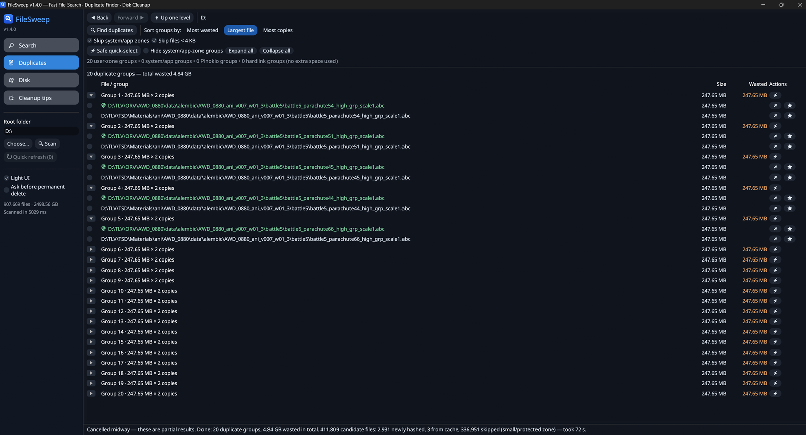
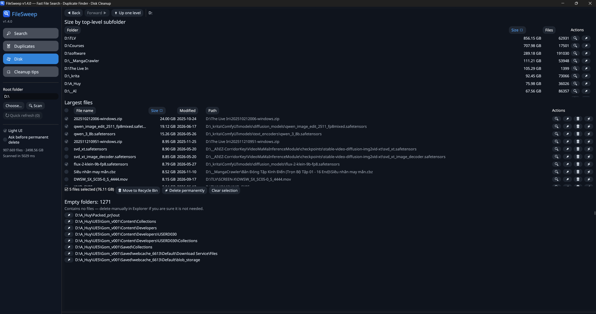

# FileSweep

**Fast file search, duplicate finder and disk cleanup for Windows — one small native app, no installer, no telemetry.**



FileSweep scans a drive once, then lets you search millions of files instantly, find true duplicates by content hash, and see exactly what is eating your disk — with cleanup suggestions that are conservative by design.

## Built for the AI era: your models are everywhere

A modern AI setup scatters **multi-gigabyte model files all over your drives** — ComfyUI checkpoints and LoRAs, Pinokio apps each with their own model folders, fine-tunes, downloads you forgot about. A single checkpoint is 8–25 GB, and the same file often sits in two or three places at once. Keeping a disk healthy in this era means constantly answering two questions: *where did my space go?* and *which of these copies do I actually still need?*

That is exactly what FileSweep is built for:

- **Fast from the first second** — the screenshot below is a real 2.5 TB drive: **907,669 files indexed in ~5 seconds**, then every search, sort and selection is instant. Picking the files you no longer need is a few clicks: tick whole duplicate groups with one button, multi-select in the largest-files list, done.
- **Hardlink-safe** — AI tools love sharing one physical model file across many folders via *hardlinks* (shared model pools in tools like Pinokio/Maestro work this way). Ordinary duplicate cleaners count hardlinks as wasted gigabytes — and deleting the wrong "copy" can corrupt the shared file, break the model, and cost you a multi-GB re-download. FileSweep detects hardlinked groups by physical file identity, flags them 🔗, counts them as **0 B wasted**, and never quick-selects them.
- **App-managed files are left alone** — protected zones (Pinokio/PionLogin stores, Windows, Program Files, AppData, conda envs) are never bulk-ticked; for app-owned duplicates you decide group by group, with the keeper always visible.



## Features

- **Instant search** — one scan builds an in-memory index (2.2M files in ~40 s); after that, name searches return as you type. The index is saved to disk and reloaded on the next launch, so the app opens ready to work.
- **Duplicate finder that doesn't guess** — files are grouped by size, then a sample hash, then a full BLAKE3 hash. A persistent hash cache makes re-runs near-instant (only new/changed files are re-hashed). Hashing runs in parallel.
- **Hardlink-aware** — groups that only look duplicated but share one physical copy are detected, flagged 🔗 and excluded from the "wasted" totals, so the numbers never lie to you.
- **Disk overview** — top-level folder sizes, largest files, empty folders.
- **Cleanup suggestions with safety tiers** — Safe (old temp files, crash dumps, caches, old logs) vs. Caution (old installers, huge untouched files — list only, never auto-deleted).
- **Protected zones** — Windows, Program Files, AppData, and app-managed stores (Pinokio, PionLogin profiles, conda envs, Sandbox) are never quick-selected or bulk-ticked. App-managed duplicate files are intentional and are left alone.
- **You always confirm** — quick-select only *ticks* extra copies (keeping a visible keeper per group, which you can override with ★ Keep); nothing is deleted without your click, and the default is the Recycle Bin. Permanent delete exists but is clearly separated and double-confirmed.
- **Light UI mode** — a flat, no-transparency theme that stays smooth on weak GPUs and over remote desktop.
- **CLI included** — `filesweep-cli` for scriptable search / duplicate / largest-file reports.

## Download

Grab the latest release zip (e.g. `FileSweep-v1.4.0.zip`) from the [Releases](../../releases) page, unzip anywhere and run `FileSweep.exe`. No installation, no admin rights needed. Windows 10/11, 64-bit.

> The executable is not code-signed yet, so Windows SmartScreen may warn on first run — choose *More info → Run anyway* if you trust the source (you can also build from source below).

## Build from source

Requires a recent stable Rust toolchain.

```sh
cargo build --release
# GUI app:  target/release/FileSweep.exe
# CLI:      target/release/filesweep-cli.exe
```

Run the test suite (8 unit tests covering the duplicate engine, the hash cache and the cleanup classifier):

```sh
cargo test --no-default-features
```

## CLI usage

```text
filesweep-cli <folder> [--search <keyword>] [--dupes] [--largest <n>]
```

## Privacy

FileSweep works fully offline. It stores its index, hash cache and settings under `%LOCALAPPDATA%\FileSweep` and never sends data anywhere.

## License

MIT — see [LICENSE](LICENSE).
